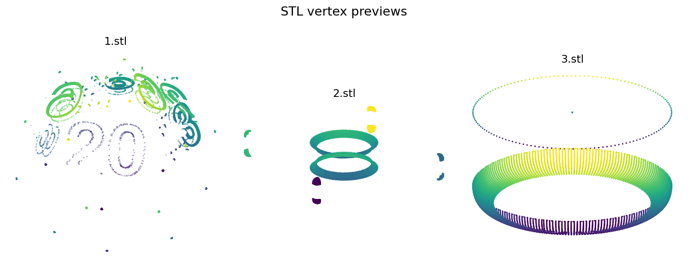

# mathproject

本仓库的高中数学报告：[从三个 STL 文件出发：三维模型、数学测量与 AI 的边界](数学报告_三维模型与人工智能.md)。报告基于对三个 STL 文件的实测——包围盒、表面积、体积与封闭性检查，全部数据可通过 `python stl_analysis.py` 复现。分析脚本本身也在仓库中（`stl_analysis.py`，约 70 行，依赖 numpy）。

本仓库目前保存三份以数字命名的 STL 模型文件（`1.stl`、`2.stl`、`3.stl`）和一份 GIF 动图（`AnimatedEmojies-512px-4.gif`）。可使用支持 STL 的三维查看软件打开模型。

*预览由 `1.stl`、`2.stl`、`3.stl` 中的实际三维顶点抽样生成，帮助快速辨认文件外形；它是点云示意，不等同于完整 STL 表面渲染，也不能用来推定作品主题或作者。*

目前尚无文字或源文件说明这些模型对应的数学主题、建模过程、制作软件、作者分工及 GIF 的来源，因此不能仅凭仓库内容判断其用途或原创范围。

后续如补充项目说明，建议逐一写明模型名称、所展示的概念、制作过程和素材来源，并加入能看清模型的预览图。本仓库尚未指定开源许可证。

当前更适合把这里看作三维模型素材归档，而不是已经完成说明的数学项目。若你保存了设计过程、建模软件界面截图或模型实际应用照片，可对照各 STL 文件名补充；GIF 的来源与复用许可也需要确认。
